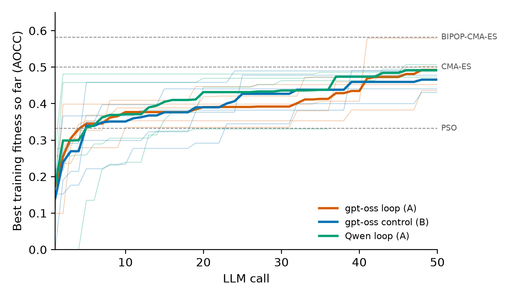
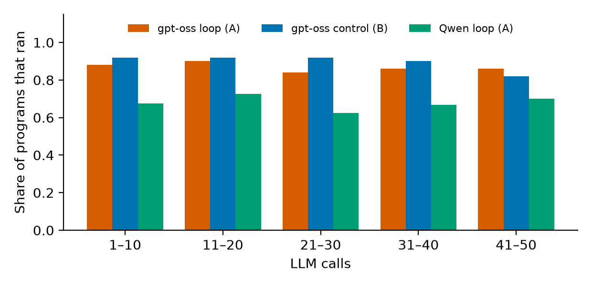

# LLM run analysis

Generated by `scripts/analyze_runs.py` from the logs in `data/results/llm_runs/`. All fitness values here are training fitness (BBOB instances 1–3, 5-D); held-out results are in the paper.

| | gpt-oss loop (A) | gpt-oss control (B) | Qwen loop (A) |
|---|---|---|---|
| Runs | 5 | 5 | 4 |
| Mean best fitness after 5 calls | 0.345 | 0.339 | 0.333 |
| Mean best fitness after 10 calls | 0.377 | 0.351 | 0.371 |
| Mean best fitness after 25 calls | 0.391 | 0.427 | 0.431 |
| Mean best fitness after 50 calls | 0.492 | 0.466 | 0.491 |
| Call at which the final best was found (median) | 46 | 25 | 38 |
| Improvements per run | 9, 5, 7, 6, 9 | 5, 4, 5, 9, 5 | 4, 12, 5, 7 |
| Error rate, calls 1–25 / 26–50 | 12% / 14% | 9% / 12% | 33% / 31% |
| Valid programs | 217 | 224 | 126 |
| Mean fitness of valid programs | 0.285 | 0.233 | 0.338 |
| Valid programs above PSO (0.332) | 34% | 16% | 52% |
| Valid programs above CMA-ES (0.5) | 1% | 0% | 1% |
| Valid programs above BIPOP-CMA-ES (0.582) | 0% | 0% | 0% |
| Child accepted (loop only) | 14% | – | 16% |
| Median tokens per call | 3,817 | 1,429 | 17,533 |
| Tokens per improvement | 25,988 | 12,831 | 111,539 |
| Median latency per call (s) | 0.9 | 0.7 | 7.5 |
| Median lines of code | 146 | 91 | 182 |
| Spearman: code length vs fitness | ρ = 0.18 (p = 0.006) | ρ = 0.13 (p = 0.052) | ρ = 0.03 (p = 0.726) |
| Valid programs using CMA-ES | 64% | 7% | 98% |
| Valid programs using Differential evolution | 71% | 50% | 7% |
| Valid programs using Particle swarm | 6% | 2% | 2% |
| Valid programs using Nelder-Mead / simplex | 8% | 2% | 0% |
| Valid programs using Restarts | 63% | 18% | 98% |

Family shares come from a keyword scan of each program's code, so they show what a program mentions, not what it does.

